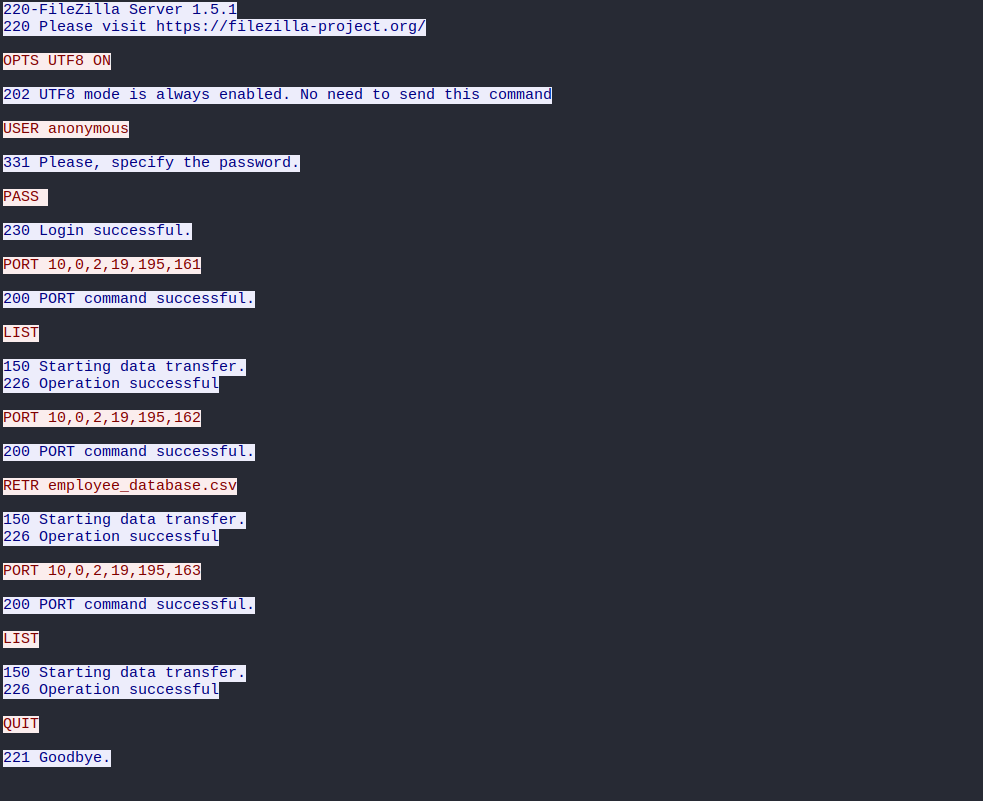
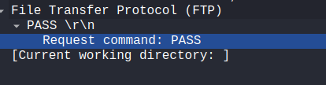
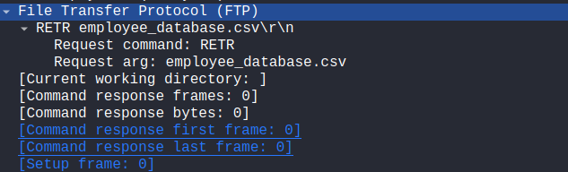
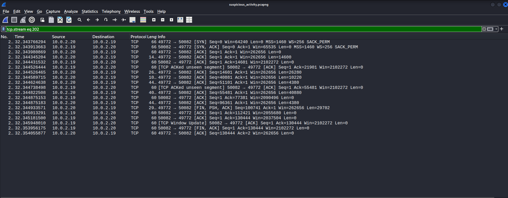
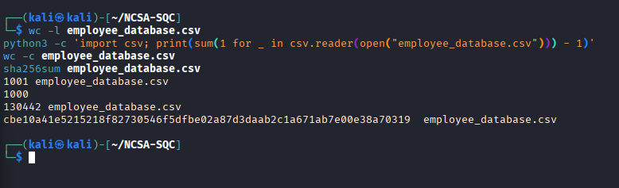

# Wireshark Data Exfiltration Investigation

## Project Overview

This project documents a simulated Security Operations Center (SOC) investigation conducted as part of my NGT Academy Cybersecurity and Network Engineering training.

The objective was to investigate suspicious network traffic, identify compromised authentication mechanisms, reconstruct transferred data, determine the scope of data exposure, and recommend security controls to prevent similar incidents.

## Incident Report

A formal SOC incident report documenting the investigation findings,
incident timeline, potential business impact, forensic evidence,
and prioritized remediation recommendations is available below.

[View Formal SOC Incident Report](Incident-Report.md)


## Executive Summary

Through network packet analysis using Wireshark and forensic verification using Kali Linux, I identified a simulated data exfiltration incident involving an insecure FTP server.

The investigation revealed successful anonymous authentication with an empty password, followed by the retrieval of an employee database containing 1,000 synthetic records with sensitive personal and financial information.

## Investigation Results

| Indicator | Finding |
|---|---|
| Incident Type | Simulated Data Exfiltration |
| Potential Severity | High |
| Suspected Attacker | 10.0.2.19 |
| Affected Server | 10.0.2.20 |
| Server Software | FileZilla Server 1.5.1 |
| Protocol | FTP / TCP |
| Username | anonymous |
| Password | Empty |
| FTP Control Port | TCP 21 |
| Client Control Port | TCP 50080 |
| Data Source Port | TCP 49772 |
| Data Destination Port | TCP 50082 |
| TCP Stream | 202 |
| Exfiltrated File | employee_database.csv |
| Recovered Records | 1,000 |
| Data Fields | 12 |
| Recovered File Size | 130,442 bytes (127.4 KiB) |
| Evidence Hash Algorithm | SHA-256 |

## Tools and Technologies

- Wireshark
- Kali Linux
- Python 3
- Linux command-line utilities
- TCP/IP
- File Transfer Protocol (FTP)
- SHA-256 hashing
- MITRE ATT&CK Framework
- GitHub

## Lab Environment

The investigation was performed in a controlled virtualized Kali Linux environment using a provided packet capture named `suspicious_activity.pcapng`.

The dataset and suspicious activity were part of an educational cybersecurity simulation.

## Investigation Methodology

### 1. Network Traffic Identification

I examined the packet capture to identify the endpoints involved in suspicious network communications.

Two internal IPv4 addresses were identified:

- 10.0.2.19 — FTP client and suspected attacker
- 10.0.2.20 — FTP server and affected host

Wireshark display filter:

```wireshark
ip.addr == 10.0.2.19 && ip.addr == 10.0.2.20
```

Identifying the communicating hosts established the scope of the investigation.

### 2. FTP Control Stream Analysis

I examined the FTP control connection using Wireshark's Follow TCP Stream functionality.

The analysis revealed:

- FileZilla Server version 1.5.1
- Anonymous authentication
- Successful login
- Directory enumeration
- File retrieval
- Successful data transfer
- Session termination

Wireshark display filter:

```wireshark
ftp
```



**Evidence 01:** FTP control stream showing authentication, directory enumeration, file retrieval, and successful transfer responses.

### 3. Authentication Analysis

I investigated the FTP authentication process to determine which credentials were used.

Wireshark display filter:

```wireshark
ftp.request.command == "PASS"
```

The packet contained the PASS command followed by carriage return and line feed characters, without a password argument.

Verified authentication findings:

- Username: anonymous
- Password: Empty
- Server response: 230 Login successful



**Evidence 02:** FTP packet inspection confirming an empty password argument.

Anonymous authentication allowed access without individual user identification, creating a significant security risk when sensitive files were accessible.

### 4. File Retrieval Investigation

Further analysis of FTP commands identified the following file retrieval request:

```text
RETR employee_database.csv
```

The RETR command instructs the FTP server to transfer a requested file to the client.

Wireshark display filter:

```wireshark
ftp.request.command == "RETR"
```



**Evidence 03:** FTP RETR command identifying the targeted employee database.

The server subsequently returned:

```text
150 Starting data transfer.
226 Operation successful.
```

These responses indicated that the server reported successful completion of the file transfer.

### 5. Data Exfiltration Port Identification

My initial investigation identified TCP port 50080. Further analysis revealed that this was the client-side FTP control connection port rather than the data transfer port.

I examined the FTP PORT command associated with the file retrieval:

```text
PORT 10,0,2,19,195,162
```

The destination port was calculated using the FTP port representation:

```text
(195 × 256) + 162 = 50082
```

This established TCP port 50082 as the destination data port associated with the employee database retrieval.

| Client Port | Purpose |
|---|---|
| 50080 | FTP control connection |
| 50081 | Initial directory listing |
| 50082 | Employee database retrieval |
| 50083 | Subsequent directory listing |

This step demonstrated the importance of validating initial findings through additional evidence correlation.

### 6. TCP Data Stream Analysis

I isolated TCP stream 202 to examine the data transfer connection.

Wireshark display filters:

```wireshark
tcp.port == 50082
```

```wireshark
tcp.stream eq 202
```

The connection transferred data from:

```text
10.0.2.20:49772 → 10.0.2.19:50082
```

The TCP stream contained:

- TCP three-way handshake
- Application data transmission
- TCP acknowledgments
- Connection termination



**Evidence 04:** TCP stream 202 showing the endpoints, data transfer ports, sequence numbers, acknowledgments, and connection termination.

#### TCP Payload Calculation

The final data-bearing packet contained:

- Relative sequence number: 100741
- Payload length: 29702 bytes
- Initial relative data sequence number: 1

```text
100741 + 29702 - 1 = 130442 bytes
```

The calculated TCP payload was 130,442 bytes.

### 7. Data Reconstruction and Classification

Using Wireshark's Follow TCP Stream functionality, I reconstructed the transferred CSV data.

The recovered database contained 12 fields representing sensitive personal and financial information.


**Evidence 05:** Sanitized CSV column headers identifying the categories of exposed information.

| Data Field | Classification |
|---|---|
| Employee ID | Internal information |
| First Name | PII |
| Last Name | PII |
| Email Address | PII |
| Gender | Personal information |
| Date of Birth | PII |
| Social Security Number | Highly sensitive PII |
| Credit Card Number | Sensitive financial information |
| Street Address | PII |
| City | Personal information |
| State | Personal information |
| Phone Number | PII |

The recovered information was transmitted in plaintext, demonstrating the confidentiality risks associated with unencrypted FTP.

### 8. Forensic Evidence Verification

After reconstructing the CSV file, I performed additional forensic verification using Kali Linux.

#### Count File Lines

```bash
wc -l employee_database.csv
```

Result: 1,001 lines.

#### Verify CSV Record Count

```bash
python3 -c 'import csv; print(sum(1 for _ in csv.reader(open("employee_database.csv"))) - 1)'
```

Result: 1,000 records, excluding the header.

#### Verify File Size

```bash
wc -c employee_database.csv
```

Result: 130,442 bytes.

#### Generate SHA-256 Evidence Hash

```bash
sha256sum employee_database.csv
```

A SHA-256 fingerprint was generated to establish a baseline for future evidence integrity verification.



**Evidence 06:** Kali Linux terminal output verifying record count, file size, and SHA-256 evidence hashing.

The recovered file size matched the calculated TCP payload size, supporting the completeness of the reconstructed file.

The generated hash establishes an integrity baseline but does not independently prove authenticity without a trusted reference hash.

## Incident Timeline

| Stage | Observed Activity |
|---|---|
| 1 | FTP connection established |
| 2 | Anonymous authentication attempted |
| 3 | Empty password accepted |
| 4 | Directory enumeration performed |
| 5 | Data port 50082 negotiated |
| 6 | employee_database.csv requested |
| 7 | TCP data connection established |
| 8 | Sensitive CSV data transferred |
| 9 | Server reported successful transfer |
| 10 | Additional directory enumeration |
| 11 | FTP session terminated |

## MITRE ATT&CK Mapping

The simulated activity is potentially consistent with the following adversary technique:

| Technique | ID | Observed Behavior |
|---|---|---|
| Exfiltration Over Unencrypted Non-C2 Protocol | T1048.003 | Sensitive data transferred using plaintext FTP |

Reference:

https://attack.mitre.org/techniques/T1048/003/

This mapping represents a potential adversary behavior within the simulated scenario. Network traffic alone does not establish attacker identity, authorization status, or intent.

## Security Findings

| Finding | Potential Risk |
|---|---|
| Anonymous FTP authentication | Unaccountable access to sensitive files |
| Empty password accepted | Weak authentication controls |
| Unencrypted FTP | Exposure of credentials and transferred information |
| Sensitive database accessible through FTP | Unauthorized data disclosure |
| Successful database retrieval | Loss of confidentiality |

## Potential Business Impact

If this incident occurred in a production environment involving genuine employee information, potential consequences could include:

- Identity theft
- Financial fraud
- Employee privacy violations
- Regulatory and compliance consequences
- Reputational damage
- Loss of organizational trust

The potential severity was assessed as High based on the sensitivity and volume of the simulated exposed information.

## Incident Response Recommendations

### Containment

- Restrict access to the affected FTP server.
- Disable unnecessary anonymous authentication.
- Preserve packet captures and relevant system logs.
- Investigate additional connections to the affected server.
- Determine the full scope of potential exposure.

### Eradication

- Remove insecure FTP configurations.
- Replace plaintext FTP with SFTP or properly configured FTPS.
- Implement individual user authentication.
- Enforce least-privilege file permissions.
- Restrict unnecessary network access.

### Recovery and Prevention

- Validate secure file transfer configurations.
- Implement network segmentation.
- Monitor unusual file transfer activity.
- Implement data loss prevention controls.
- Forward authentication and network logs to a SIEM.
- Conduct periodic security configuration reviews.

## Detection Opportunities

A SOC could monitor for:

- Anonymous FTP login attempts.
- Successful anonymous authentication.
- FTP retrieval commands targeting sensitive filenames.
- Unusual outbound data transfers from sensitive servers.
- FTP activity involving unexpected hosts.
- Unencrypted transmission of sensitive information.

These detection opportunities could be incorporated into a SIEM platform such as Splunk.

## Skills Demonstrated

- Network traffic analysis
- Packet capture investigation
- Wireshark display filtering
- TCP/IP protocol analysis
- FTP protocol analysis
- Authentication analysis
- Data exfiltration investigation
- TCP stream reconstruction
- Digital forensics
- Linux command-line operations
- Python scripting
- SHA-256 evidence hashing
- Sensitive data classification
- Evidence correlation
- Incident response recommendations
- MITRE ATT&CK mapping
- Technical documentation

## Lessons Learned

This investigation strengthened my understanding of how network traffic can reveal suspicious authentication, file access, and data exfiltration activity.

I learned the importance of distinguishing FTP control connections from data connections, validating initial findings, reconstructing transferred information, and verifying recovered evidence through independent forensic calculations.

The investigation also demonstrated how insecure authentication and unencrypted protocols can expose sensitive organizational information.

## Investigation Limitations

The investigation was based on network packet evidence from a simulated training environment.

Additional server logs, endpoint telemetry, access control configurations, and authorization records would be required to establish definitive root cause and attacker intent in a production investigation.

## Ethical and Data Privacy Disclaimer

This project was completed in a controlled educational environment as part of NGT Academy cybersecurity training.

The recovered database contained 1,000 synthetic records. Individual record values have been excluded from public evidence to demonstrate responsible data handling and professional SOC analyst practices.

The original packet capture and recovered CSV are not included in this repository.

No production systems or real individuals were targeted.

## Author

Dalton McAuliffe

CompTIA Security+ Certified | NGT Academy Cybersecurity and Network Engineering Graduate | U.S. Army Veteran

Focused on developing practical skills in SOC operations, cybersecurity analysis, network security, and digital forensics.
